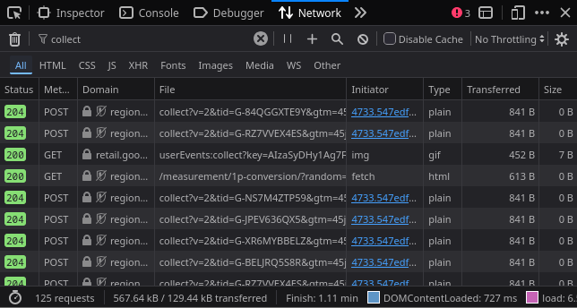
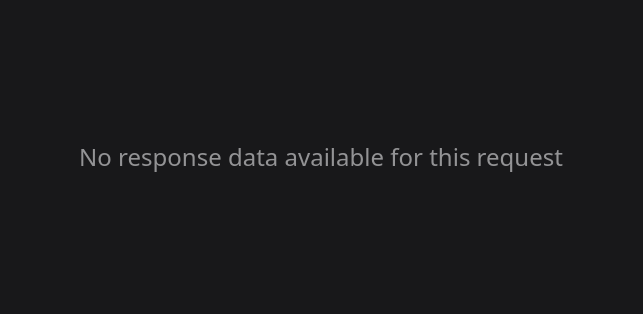

# Домашняя работа № 1 · Путь данных от ссылки до заявки

**Дисциплина:** ОП.03 «Информационные технологии»

| Поле | Значение |
|---|---|
| Фамилия, имя, отчество | Селезнев Александр Евгеньевич |
| Группа | РПО25/1 |
| Номер работы | 1 |
| Тема работы | Цифровая воронка: путь данных от ссылки до заявки |
| Дата сдачи | 15.10 |
| Ветка | `hw-01` |

---

## Задание

1. Открыть сайт, панель разработчика (F12) → **Network**, в фильтре `collect`,
   галочка **Preserve log**.
2. Сделать три действия: обновить страницу, прокрутить до низа, нажать
   на товар. Записать, какие события ушли — параметр `en` на вкладке **Payload**.
3. Описать путь пользователя от ссылки до заявки, пять шагов.
4. Найти одно место на этом пути, где данные могут потеряться.
5. Приложить скриншоты `screens/01-network.png` и `screens/02-payload.png`.

Сайт: https://shop.merch.google/, запасные — https://habr.com/ru/,
https://www.smashingmagazine.com/, https://css-tricks.com/. Открывать
в Chrome или Edge с выключенным блокировщиком рекламы.

Срок — до начала занятия 2. Ветка `hw-01`, запрос на слияние в свою `main`.

---

## 1. Какой сайт смотрел

| Поле | Значение |
|---|---|
| Название сайта | Google Merchandise Store |
| Адрес | https://shop.merch.google/ |
| Откуда сайт | из списка в задании |

## 2. Три действия и что отправил счётчик

Панель Network, фильтр `collect`, галочка Preserve log. Название события
лежит в параметре `en` на вкладке Payload.

| № | Что я сделал на сайте | Название события (`en`) | Что ещё было в Payload |
|---|---|---|---|
| 1 | обновил страницу | `page_view` (запрос заблокирован) | Вкладка Payload пуста / параметры отсутствуют из-за блокировки исходящего запроса трекинга браузером |
| 2 | прокрутил до низа | `scroll` (запрос заблокирован) | Вкладка Payload пуста (запрос collect отсечён защитой от отслеживания) |
| 3 | нажал на товар (или на ссылку) | `select_item` (запрос заблокирован) | Вкладка Payload пуста (тело POST-запроса не сформировано клиентом) |

Скриншоты:

## 3. Путь пользователя: 5 шагов

От ссылки до заявки, своими словами. Панель для этого не нужна: это рассказ
о том, как человек доходит до кнопки «Отправить». В правом столбце стоит
пример, в левом вы пишете свой вариант.

| № | Мой шаг | Пример |
|---|---|---|
| 1 | Пользователь кликнул по рекламному промо-посту с акцией в Telegram-канале | *человек увидел ссылку в сообществе и нажал на неё* |
| 2 | Загрузилась главная страница каталога с промо-товарами | *открылась главная страница сайта* |
| 3 | Посетитель открыл карточку интересующего товара и пролистал вниз до блока обратной связи | *он прокрутил до формы записи* |
| 4 | Заполнил поля формы: имя, контактный адрес почты и интересующий размер | *начал заполнять: имя и телефон* |
| 5 | Нажал на кнопку «Отправить заявку», данные ушли менеджеру магазина | *нажал «Отправить», заявка ушла менеджеру* |

## 4. Где данные могут потеряться

| № | На каком шаге | Что может потеряться |
|---|---|---|
| 1 | Шаг 1 → Шаг 2 (Переход по внешней ссылке и загрузка сайта) | Встроенная защита браузера от отслеживания (Enhanced Tracking Protection) или расширения приватности блокируют выполнение скриптов сбора аналитики и отправку сетевых запросов `collect`. В результате тело запроса (Payload) оказывается пустым либо запрос блокируется на стороне клиента (ERR_BLOCKED_BY_CLIENT), и сессия пользователя вообще не фиксируется в аналитике. |
| 2 | Шаг 4 → Шаг 5 (Отправка контактной формы) | Если у пользователя включен строгий блокировщик трекеров, валидация полей в браузере сработает, но фоновый аналитический запрос с событием генерации лида отсекается, из-за чего теряется связка между рекламным источником и фактом оформления заявки. |

## 5. Использование ИИ

| Вопрос | Ответ |
|---|---|
| Что сделал сам | Открыл сайт в браузере, выполнил три целевых действия, отфильтровал запросы collect в Network DevTools, зафиксировал блокировку и пустое состояние Payload на скриншотах. |
| Что спросил у модели | Анализ причин отсутствия параметров во вкладке Payload и техническое описание влияния механизмов защиты от отслеживания на сетевой уровень аналитики. |
| Что после этого изменил | Оформил таблицу событий с указанием факта блокировки полезной нагрузки браузером и заполнил сценарии потери данных на стыках воронки. |