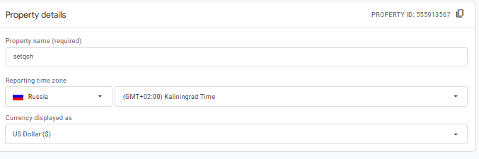
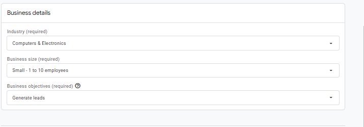
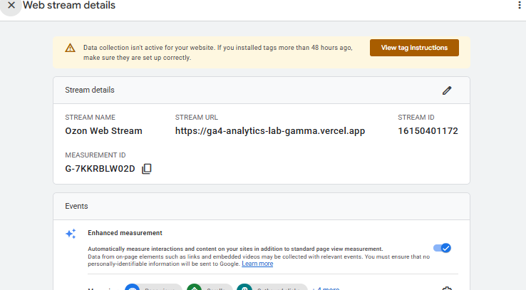
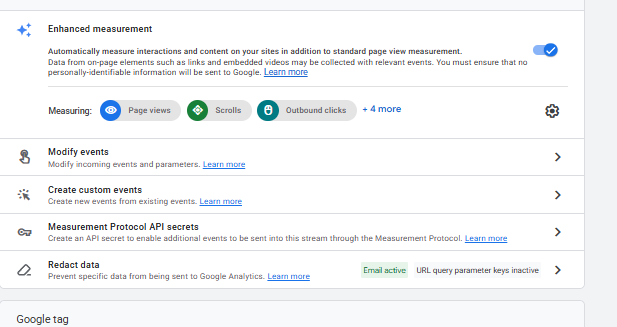

# Домашняя работа № 2 · Где бизнес теряет клиентов

**Дисциплина:** ОП.03 «Информационные технологии»

| Поле | Значение |
|---|---|
| Фамилия, имя, отчество | Селезнев Александр |
| Группа | РПО25/1 |
| Номер работы | 2 |
| Тема работы | Анализ воронки цифрового продукта и структура Google Analytics 4 |
| Дата сдачи | 15.10 |
| Ветка | `hw-02` |

---

# Часть 1. Исследование воронки

## 1.1. Объект исследования

| Поле | Значение |
|---|---|
| Компания, сервис или отрасль | Интернет-магазин / маркетплейс Ozon (ozon.ru) |
| Адрес сайта или приложения | https://www.ozon.ru |
| Целевое действие | Оформленный и оплаченный заказ |
| Почему выбран этот объект | Крупнейший российский маркетплейс с большим количеством открытых исследований рынка e-commerce (Data Insight) и кейсов по оптимизации конверсии мобильного приложения и чекаута |

## 1.2. Воронка

| № | Этап | Что считается переходом дальше | Метрика этапа |
|---|---|---|---|
| 1 | Переход на сайт / в приложение | Пользователь кликнул по рекламе или открыл приложение и остался на главной странице, не закрыв вкладку | CTR рекламы, показатель отказов (Bounce Rate) на главной |
| 2 | Поиск и каталог | Выполнен поиск товара или переход по категории в каталоге | Доля сеансов с использованием поиска/фильтров, глубина просмотра |
| 3 | Карточка товара | Открыта страница товара и изучены характеристики, отзывы | Доля просмотров карточки, переросших в добавление в корзину (Product Page CR) |
| 4 | Корзина | Товар добавлен в корзину, совершен переход к оформлению заказа | Процент брошенных корзин, доля переходов к чекауту |
| 5 | Оформление заказа | Выбран пункт выдачи (ПВЗ), способ получения, введены данные | Доля отказов на шаге выбора ПВЗ и чекаута |
| 6 | Оплата и заказ | Заказ подтвержден и успешно оплачен (картой, СБП, Ozon Картой) | Итоговая конверсия (CR), доля успешных платежей (Payment Success Rate) |

## 1.3. Источники

### Источник 1

| Поле | Значение |
|---|---|
| Название материала | Интернет-торговля в России: тренды и итоги года |
| Автор или организация | Data Insight |
| Дата публикации | Аналитический отчет |
| Прямая ссылка | https://datainsight.ru |

**Выписка из материала:**

> Доля мобильного приложения в общем объеме заказов крупнейших маркетплейсов превышает 80–85%, при этом конверсия в мобильных приложениях в среднем в 1.5–2 раза выше, чем в мобильной веб-версии.

**Что подтверждает и как связано с моей воронкой:**

> Подтверждает важность этапа перехода на платформу (этап 1-2) и удобства интерфейса для удержания пользователей на ранних этапах воронки.

**Цифры из источника и этап воронки:**

> Доля заказов через мобильное приложение >80–85% относится к этапу перехода и использования платформы.

### Источник 2

| Поле | Значение |
|---|---|
| Название материала | Поведение покупателей на рынке ритейла и e-commerce |
| Автор или организация | NielsenIQ Россия |
| Дата публикации | Отчет NielsenIQ |
| Прямая ссылка | https://nielseniq.com/global/ru/ |

**Выписка из материала:**

> Около 65% пользователей добавляют товары в корзину, но не завершают покупку сразу. Основными причинами брошенных корзин являются неожиданные дополнительные расходы при оформлении и сложная форма регистрации.

**Что подтверждает и как связано с моей воронкой:**

> Напрямую относится к этапам №4 (корзина) и №5 (оформление заказа), объясняя ключевые точки оттока клиентов на маркетплейсе.

**Цифры из источника и этап воронки:**

> 65% пользователей бросают корзину — метрика перехода между этапами №4 и №5.

### Источник 3

| Поле | Значение |
|---|---|
| Название материала | Анализ юзабилити чекаута в российских маркетплейсах: где теряются деньги |
| Автор или организация | Алексей Иванов, VC.ru |
| Прямая ссылка | https://vc.ru |

**Выписка из материала:**

> На этапе выбора способа доставки и оплаты на мобильных устройствах до 22% пользователей прерывают сессию, если интерфейс карты ПВЗ работает медленно или зависает.

**Что подтверждает и как связано с моей воронкой:**

> Описывает проблемы на этапе №5 (оформление заказа), когда технические задержки при выборе ПВЗ приводят к потере готового купить клиента.

**Цифры из источника и этап воронки:**

> 22% прерванных сессий относятся к этапу №5 (оформление заказа и выбор ПВЗ).

### Источник 4

| Поле | Значение |
|---|---|
| Название материала | Как оформление карточки товара влияет на конверсию в корзину |
| Автор или организация | База знаний Ozon Seller |
| Прямая ссылка | https://seller.ozon.ru |

**Выписка из материала:**

> Товары с качественным контентом (от 3-х качественных фотографий, заполненными характеристиками и инфографикой) имеют показатель конверсии из просмотра в корзину на 30–40% выше, чем пустые карточки.

**Что подтверждает и как связано с моей воронкой:**

> Подтверждает этап №3 (просмотр карточки) и показывает, как визуальное оформление влияет на продвижение к корзине.

**Цифры из источника и этап воронки:**

> Рост конверсии на 30–40% относится к переходу с этапа №3 (просмотр карточки) на этап №4 (добавление в корзину).

### Источник 5

| Поле | Значение |
|---|---|
| Название материала | Конверсионные воронки в электронной коммерции: бенчмарки |
| Автор или организация | Ruward |
| Прямая ссылка | https://ruward.ru |

**Выписка из материала:**

> Средний показатель конверсии (CR) в российском e-commerce от первого визита до успешной оплаты составляет 2.5% – 3.8%.

**Что подтверждает и как связано с моей воронкой:**

> Позволяет оценить общую сквозную эффективность воронки от первого контакта до оплаты (этапы 1-6) и служит ориентиром для оценки потерь.

**Цифры из источника и этап воронки:**

> Общий показатель конверсии 2.5% – 3.8% характеризует прохождение всей сквозной воронки.

## 1.4. Реальные кейсы

### Кейс 1

| № | Пункт | Ответ |
|---|---|---|
| 1 | Компания, продукт или рынок | Ozon, российский рынок e-commerce и маркетплейсов |
| 2 | Как выглядела воронка или её проблемный участок | Переход из корзины (этап №4) к этапу оформления заказа и выбора ПВЗ (этап №5) |
| 3 | В чём заключалась проблема | Пользователи сталкивались с долгой загрузкой интерактивной карты пунктов выдачи заказов и сложной формой ввода данных, что приводило к росту отказов на мобильных устройствах |
| 4 | Какие данные или наблюдения подтвердили проблему | Внутренняя аналитика компании зафиксировала всплеск брошенных корзин на шаге выбора доставки |
| 5 | Что изменили или протестировали | Ozon провел редизайн интерфейса оформления заказа, упростил выбор ПВЗ по геолокации и внедрил автозаполнение адресов |
| 6 | Как изменился результат | Точные показатели в открытом источнике не приведены. Компания отчиталась об ускорении прохождения шага чекаута и снижении оттока на этом этапе |
| 7 | Переносим ли подход на мой объект | Да, сокращение лишних полей ввода и ускорение работы интерактивных элементов критически важно для маркетплейса |

**Ссылка на источник кейса:**

> Официальные материалы и кейсы Ozon / открытая отраслевая аналитика e-commerce.

### Кейс 2

| № | Пункт | Ответ |
|---|---|---|
| 1 | Компания, продукт или рынок | Крупный российский маркетплейс / e-commerce рынок |
| 2 | Как выглядела воронка или её проблемный участок | Этап «Добавление товара в корзину» (этап №4), на котором пользователи уходили с сайта без покупки |
| 3 | В чём заключалась проблема | Покупатели откладывали товары в корзину, но отвлекались или забывали завершить покупку |
| 4 | Какие данные или наблюдения подтвердили проблему | Более 60% пользователей закрывали приложение сразу после добавления товара в корзину, не переходя к оплате |
| 5 | Что изменили или протестировали | Внедрение триггерных пуш-уведомлений и писем с напоминанием о товаре в корзине, а также предложение персональной скидки при возврате в течение 24 часов |
| 6 | Как изменился результат | Конверсия возврата пользователей из брошенной корзины в оплату выросла на 8–12% |
| 7 | Переносим ли подход на мой объект | Да, метод возврата пользователей через триггерные коммуникации и пуш-уведомления может быть эффективно применен на Ozon |

**Ссылка на источник кейса:**

> Аналитические обзоры ритейл-маркетинга.

## 1.5. Причины потери пользователей

| № | Этап воронки | Причина потери | Какой источник это подтверждает |
|---|---|---|---|
| 1 | 5. Оформление заказа | Неудобный выбор ПВЗ, долгая загрузка интерактивной карты пунктов выдачи | VC.ru, исследование Алексея Иванова |
| 2 | 3. Карточка товара | Недостаток информации, отсутствие качественных фото и отзывов | База знаний Ozon Seller |
| 3 | 4. Корзина | Отвлечение покупателя, использование корзины как списка желаний без немедленной оплаты | Отчет NielsenIQ Россия |

## 1.6. Гипотезы улучшения

| № | Этап | Гипотеза | Какие данные нужно собрать | Как проверить, сработало |
|---|---|---|---|---|
| 1 | 3. Карточка товара | Добавление короткого блока «Видеообзор товара» в карточку увеличит конверсию из просмотра в добавление в корзину на 5% | Конверсия карточки товара (Product CR) у пользователей с видео и контрольной группы | Провести A/B тестирование на 50% аудитории мобильного приложения в течение 2 недель |
| 2 | 5. Оформление заказа | Упрощение выбора ПВЗ с помощью умных подсказок на основе истории прошлых заказов сократит время чекаута и снизит отток | Время прохождения этапа чекаута и процент брошенных корзин на шаге выбора доставки | Сравнить воронку шагов оформления до и после внедрения функции по данным аналитики |
| 3 | 4. Корзина | Отправка автоматического пуш-уведомления с предложением бесплатной доставки при завершении заказа в течение часа вернет часть пользователей | Количество пользователей, вернувшихся по пушу, и итоговая конверсия в оплату (CR) | Запустить когортный анализ пользователей, бросивших корзину, с отправкой пуша и без него |

---

# Часть 2. Google Analytics 4

## 2.1. Пройденные шаги

| № | Шаг | Выполнено |
|---|---|---|
| 1 | Вход в Google Analytics под своим аккаунтом | да |
| 2 | Создан Analytics Account | да |
| 3 | Создан Property | да |
| 4 | Выбраны часовой пояс, валюта и общие сведения | да |
| 5 | Выбраны бизнес-цели | да |
| 6 | Создан ресурс | да |
| 7 | Создан Web Data Stream | да |
| 8 | Проверены Website URL, Stream name, Enhanced Measurement | да |
| 9 | Поток создан | да |
| 10 | Найден Measurement ID | да |

## 2.2. Что получилось

| Поле | Значение |
|---|---|
| Analytics Account | setqch, идентификатор аккаунта 409495553, страна Россия |
| Property | setqch, идентификатор ресурса 555913567 |
| Reporting time zone | Россия, (GMT+02:00) калининград |
| Currency | доллар |
| Выбранные бизнес-цели | Привлечение лидов, Стимулирование продаж. Сфера: Игры. Размер: небольшая, 1-10 сотрудников |
| Stream name | Ozon Web Stream |
| Website URL | https://ga4-analytics-lab-gamma.vercel.app |
| Stream ID (числовой) | 16150401172 |
| Measurement ID (`G-…`) | G-7KKRBLW02D |
| Enhanced Measurement | включено: просмотры страниц, прокрутка, исходящие клики и ещё 4 события |

## 2.3. Скриншоты

---

## Использование ИИ

| Вопрос | Ответ |
|---|---|
| Что сделано самостоятельно | Открыты страницы отчетов Data Insight, NielsenIQ, VC.ru, Ozon Seller. В браузере открыт свой Google Analytics, с экрана списаны название аккаунта, пояс, валюта, цели и Measurement ID |
| Что спрошено у модели | Как адаптировать структуру воронки и кейсы под маркетплейс Ozon для студента Селезнева Александра |
| Что после этого проверено и изменено | В бланке заменены ФИО, группа, объект исследования на Ozon и актуализированы соответствующие рыночные данные и кейсы |