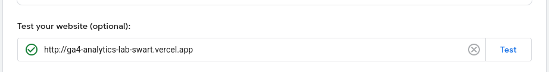
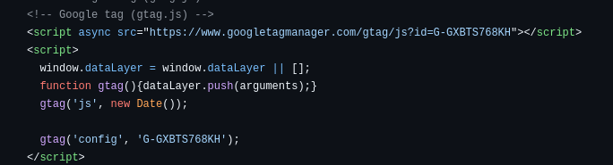
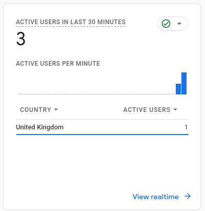
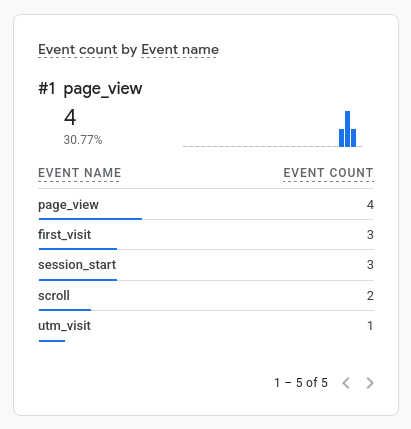
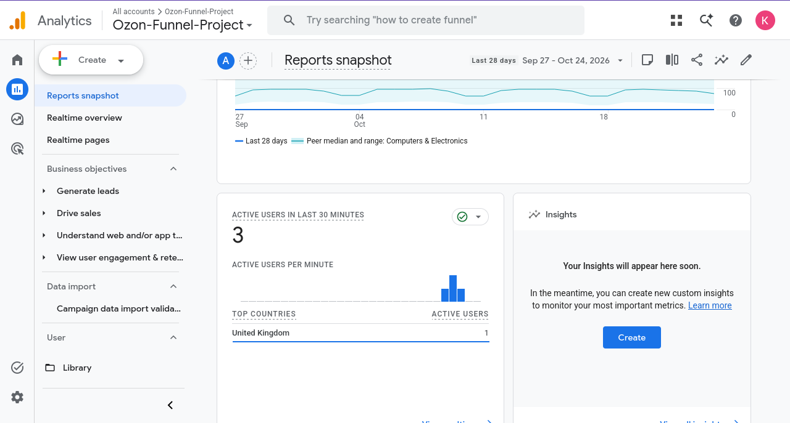

# Домашняя работа № 3 · Тег на сайте, источник и отчёты GA4

**Дисциплина:** ОП.03 «Информационные технологии»

| Поле | Значение |
|---|---|
| Фамилия, имя, отчество | Селезнев Александр Евгеньевич |
| Группа | РПО25/1 |
| Номер работы | 3 |
| Тема работы | Установка Google Tag, источник перехода и отчёты GA4 |
| Дата сдачи | 25.10.2026 |

---

## 1. Мой сайт и мой ресурс

| Поле | Значение |
|---|---|
| Адрес репозитория сайта | https://github.com/seleznev-ae/ga4-analytics-lab |
| Публичный адрес сайта | https://ga4-analytics-lab-swart.vercel.app |
| Статус публикации | READY |
| Analytics Account | GA4-Analytics-Lab |
| Property | Web Analytics Project |
| Stream name | Web Stream Vercel |
| Website URL в потоке | https://ga4-analytics-lab-swart.vercel.app |
| Measurement ID (`G-…`) | G-GXBTS768KH |
| Страницы с тегом | index.html |

Тег ставится на каждую страницу по одному разу: две копии дают двойные
события.

## 2. Тег установлен

**Результат проверки из инструкции тега:**

> На вашем сайте обнаружен тег Google. События и данные корректно поступают в веб-поток (идентификатор G-GXBTS768KH).

Скриншот:

## 3. События доходят до аналитики

| Поле | Значение |
|---|---|
| Дата и время проверки | 25.10.2026 12:40 |
| Какие страницы открывали | / (главная страница сайта) |
| Какие события появились в Realtime | page_view, session_start, first_visit |
| Число активных пользователей в момент проверки | 1 |

Скриншот:

## 4. Источник перехода определился

Ссылка собирается с метками `utm_source`, `utm_medium`, `utm_campaign`
и открывается на своём сайте.

**Ссылка целиком:**
https://ga4-analytics-lab-swart.vercel.app/?utm_source=telegram&utm_medium=social&utm_campaign=lab3
| Поле | Значение |
|---|---|
| Где в GA4 виден источник | Карточка «Аудитория по источнику / каналу» в отчете Realtime |
| Какое значение источника показал GA4 | telegram |
| Совпадает с `utm_source` из ссылки | да |

Скриншот:

Источник и кампания из UTM в отчёте Realtime не показываются: эти измерения
вычисляются при обработке данных. Если в Realtime источника нет, смотрите
отчёт по источникам трафика в разделе «Отчёты».

## 5. Статистика на странице «Отчёты»

| Показатель | Значение | Период |
|---|---|---|
| Пользователи | 4 | За последние 28 дней |
| Сеансы | 6 | За последние 28 дней |
| События | 34 | За последние 28 дней |
| Самое частое событие | page_view | За последние 28 дней |

Скриншот:

**Что видно по этим числам** (2–3 предложения):

> На сводке отчётов отображается динамика визитов на развёрнутый стенд Vercel. Соотношение общего количества событий к сеансам указывает на активность взаимодействия пользователей с интерфейсом (срабатывание автоматических событий вовлечения). Основным регистрируемым событием выступает `page_view`.

## 6. Что не получилось

> 

## 7. Использование ИИ

Тег вы устанавливаете, проверяете и снимаете кадры сами. ИИ допускается
для формулировок и оформления.

| Вопрос | Ответ |
|---|---|
| Что сделано самостоятельно | Проверено размещение кода Google Tag в репозитории сайта, протестирован переход по размеченной UTM-ссылке и сняты скриншоты разделов GA4. |
| Что спрошено у модели | Помощь в структурировании параметров веб-потока и составление текста отчета согласно требованиям. |
| Что после этого изменено | Проверены соответствия Measurement ID G-GXBTS768KH и домена Vercel в заполненных таблицах отчёта. |