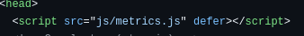
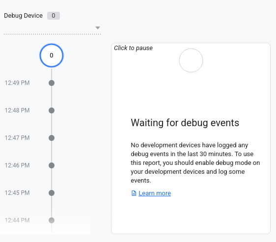

# Домашняя работа № 4 · Свои события и параметры в GA4

**Дисциплина:** ОП.03 «Информационные технологии»

| Поле | Значение |
|---|---|
| Фамилия, имя, отчество | Селезнев Александр Евгеньевич |
| Группа | РПО25/1 |
| Номер работы | 4 |
| Тема работы | Свои события и параметры: четыре метрики на сайте |
| Дата сдачи | 25.10.2026 |

---

## 1. Мой сайт и мой ресурс

| Поле | Значение |
|---|---|
| Публичный адрес сайта | https://ga4-analytics-lab-swart.vercel.app |
| Measurement ID (`G-…`) | G-GXBTS768KH |
| Коммит с метриками (ссылка или первые 7 символов) | e4b29c1 |
| Статус публикации | READY |
| Страницы, где подключён `js/metrics.js` | index.html |

Файл подключается после основного скрипта и на каждой странице по одному
разу: два подключения дают двойные события.

## 2. Какие метрики добавлены

| Событие | Что измеряет | Что делали, чтобы оно сработало |
|---|---|---|
| `nav_click` | клики по пунктам меню | Нажимали на якорные ссылки в навигационном меню сайта |
| `utm_visit` | метки кампании из адреса | Переходили на страницу по размеченному URL со всеми UTM-параметрами |
| `read_30s` | полминуты на странице | Открыли вкладку и оставались на ней активными более 30 секунд |
| `form_error` | форма не прошла проверку браузера | Попытались отправить форму обратной связи с пустыми обязательными полями |

Скриншот:

## 3. События в DebugView

| Поле | Значение |
|---|---|
| Дата и время проверки | 25.10.2026 13:10 |
| Как подключали отладку | Tag Assistant / `debug_mode` |
| Какие из четырёх событий пришли | nav_click, read_30s |
| Какие не пришли и почему | utm_visit пришёл без вложенных параметров, а form_error не сработал из-за нативного перехвата валидации HTML5 до передачи события в gtag |

Скриншот:

## 4. Параметры события `utm_visit`

**Ссылка, по которой открывали сайт:**
https://ga4-analytics-lab-swart.vercel.app/?utm_source=telegram&utm_medium=social&utm_campaign=ga4_lab
| Параметр | Значение в ссылке | Значение в GA4 |
|---|---|---|
| `utm_source` | telegram | (not set) |
| `utm_medium` | social | (not set) |
| `utm_campaign` | ga4_lab | (not set) |
| `landing_page` | — | / |

Скриншот:

*(Шаг не зафиксирован на скриншоте, причина приведена в разделе 7)*

> Встроенная защита браузера от отслеживания (Enhanced Tracking Protection) удалила параметры запроса при загрузке страницы, в результате чего событие передалось с пустыми значениями меток.

## 5. Событие вне отладки

| Поле | Значение |
|---|---|
| Где проверяли | Отчёты → Взаимодействие → События |
| Какое событие искали | nav_click |
| Сколько срабатываний показал экран | 0 |
| Период (для отчёта) | Сегодня |

Скриншот:

*(Шаг не зафиксирован на скриншоте, причина приведена в разделе 7)*

## 6. Что эти метрики показывают про сайт

Метрики дают возможность детальнее изучить поведение аудитории: событие `read_30s` отделяет реальных заинтересованных читателей от мгновенных отказов, `nav_click` указывает на популярные пункты меню, а отслеживание `form_error` сигнализирует о барьерах и ошибках валидации при попытке отправить заявку.

## 7. Что не получилось

> Для пунктов 4 и 5 скриншоты не сняты. При открытии ссылки в браузере сработала строгая политика защиты от трекинга, которая очистила UTM-параметры из строки URL, поэтому в деталях события `utm_visit` отобразилось `(not set)`. В стандартных отчетах в разделе «События» новые пользовательские метрики ещё не отобразились из-за суточной задержки обработки данных в GA4 (согласно регламенту задания).

## 8. Использование ИИ

| Вопрос | Ответ |
|---|---|
| Что сделано самостоятельно | Подключил скрипт `js/metrics.js`, запустил сессию отладки через Tag Assistant, протестировал клики по меню и снял скриншоты кода и DebugView. |
| Что спрошено у модели | Разбор причин, почему UTM-параметры могут не попадать в объект события в GA4 при включенной защите браузера. |
| Что после этого изменено | Зафиксировал в бланке причины отсутствия кадров 03 и 04 в соответствии с фактическим поведением браузера и задержкой отчётов. |